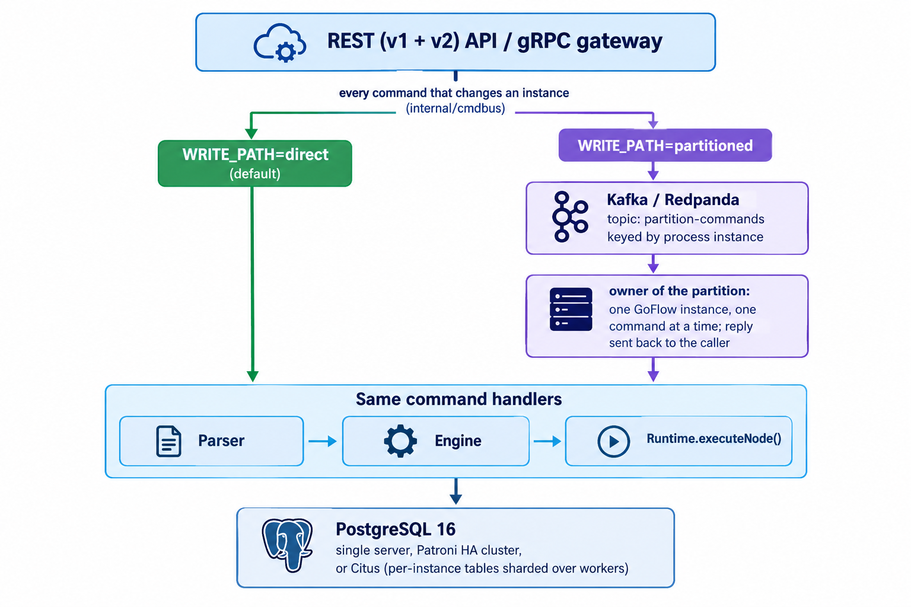

# GoFlow — Cloud-Native BPMN Workflow Engine


GoFlow is a BPMN 2.0 workflow engine written in Go that runs models with Camunda 8 semantics, exposing REST APIs shaped after both **Camunda 7** (`/engine-rest/...`) and **Camunda 8** (`/v2/...`), plus a native **Zeebe gRPC gateway**. It's a lightweight, self-hosted alternative to the Java-based engines: PostgreSQL is its only database (a single server, a high-availability cluster with automatic failover, or a Citus cluster sharding the per-instance tables), the application runs as one instance or several behind a load balancer, and it comes with real-time event streaming and a React operations/tasklist frontend. Like Camunda 8, it can run every command of an instance on the one GoFlow instance owning its Kafka partition, with failover between instances. See [Comparison to Camunda 7 / Camunda 8](docs/comparison.md#comparison-to-camunda-7--camunda-8) for an honest look at what's covered and what isn't, and [Switching from Camunda 7 / Camunda 8](docs/switching-from-camunda.md#switching-from-camunda-7--camunda-8) for what an existing Camunda application has to change.

## Contents

- [Current State](#current-state-v10)
- [Quick Start](#quick-start)
- [Frontend](#frontend)
- [Architecture](#architecture)
- [Documentation](#documentation)

---

## Current State (v1.0)

**GoFlow 1.0 is production ready.** What backs this:

- **Tested end to end:** 48 integration suites run against a real Postgres + GoFlow stack, in every deployment mode (single server, several instances, Patroni HA cluster, Citus, partitioned write path). See [Integration Tests](docs/testing.md).
- **No single point of failure:** several GoFlow instances behind a load balancer, and a Patroni cluster with automatic failover. In the failover drill, a replica took over within 28 s with no instance lost. See [Operations](docs/operations.md#postgres-high-availability).
- **Backups:** `pg_dump` backups, with a script that checks each backup restores. See [Operations](docs/operations.md#backups).
- **Secure defaults:** with `GOFLOW_ENV=production`, the server refuses to start with a sample JWT secret, and warns when `/metrics` is left without `METRICS_TOKEN`.
- **Operable:** Prometheus metrics, history retention, manual SQL migrations from a baseline, load-testing script. See [Operations](docs/operations.md).

What GoFlow does not cover yet compared with Camunda is listed in [Comparison to Camunda 7 / Camunda 8](docs/comparison.md).

### BPMN 2.0 Support

Every supported element (events, tasks, gateways, sub-processes, multi-instance, compensation, timers…) is listed in [BPMN 2.0 Support](docs/bpmn-support.md).

### Engine Features

Versioning, FEEL, job workers, incidents, DMN, multi-tenancy, authentication, audit trail, real-time events, scaling, high availability, gRPC… are listed in [Engine Features](docs/engine-features.md).

---

## Quick Start

```bash
# Clone
git clone <repo>
cd camunda-like

# Start everything (PostgreSQL + GoFlow)
docker compose up -d --build --wait

# Default superuser: admin@goflow.com / admin123 (seeded from docker-compose.yaml)
```

The API is available at `http://localhost:8080` (REST) and `localhost:26500` (gRPC — Zeebe protocol core loop, see [Roadmap](docs/roadmap.md#roadmap)).

---

## Frontend

A React 19 + `bpmn-js` single-page app (`frontend/`, dockerized behind nginx) covering a slice of Camunda's Operate + Tasklist:

- **Dashboard** — at-a-glance counts (running/completed instances, open tasks, incidents)
- **Process Definitions / Process Instances** — deploy, browse, filter by key/state
- **Instance Detail** — live BPMN diagram with an active-token overlay, plus a **replay control**: play/pause/step/scrub through the instance's full audit-log-derived token history, with a distinct pulsing marker on the diagram showing where the token was at each step (independent of the live-state overlay). Clicking a row in the Activity History timeline jumps the replay straight to that step. Also supports Move Token (process instance modification) and **Previous step** (send a token back to the wait state before, with a preview of where it goes) from here.
- **Tasks** — task inbox with claim/unclaim/complete, filtered to open tasks by default
- **History** — historic process instance list/filter
- **Incidents** — incident list with retry/resolve
- **Analytics** — duration distributions, throughput over time, and incident rate by process key (Optimize-lite)
- **Admin** — Users/Roles management and per-process VIEW/START/MANAGE permission grants

A `/modeler` page also lets you author and deploy BPMN diagrams directly in-browser (bpmn-js's editable `Modeler` build + a properties panel for Zeebe task/gateway properties) — see below.

---

## Architecture

Every request goes through the same parser/engine/runtime and lands in the same PostgreSQL database. What the deployment chooses (`WRITE_PATH`) is *where* each command runs: right where it arrives (`direct`, the default), or — like Camunda 8 — on the one GoFlow instance owning the Kafka partition of its process instance (`partitioned`).



Design decisions and the partitioned write path: [docs/architecture.md](docs/architecture.md).

---

## Documentation

- [Switching from Camunda 7 / Camunda 8](docs/switching-from-camunda.md) — what an application already on Camunda changes, client by client
- [Comparison to Camunda 7 / Camunda 8](docs/comparison.md) — what's covered and what isn't
- [BPMN 2.0 Support](docs/bpmn-support.md) — every supported BPMN element, timers, conditional events, known limits
- [Engine Features](docs/engine-features.md) — everything besides BPMN elements: FEEL, jobs, incidents, DMN, auth, scaling, HA, gRPC
- [API Reference](docs/api.md) — REST (`/engine-rest`, `/v2`), events, audit trail, every filter
- [Java client](docs/java-client.md) — a remote Java application over REST, the Camunda 7 External Task Client or the Camunda 8 Java client, with tested examples
- [Architecture](docs/architecture.md) — design decisions, partitioned write path
- [Environment Variables](docs/configuration.md) — every setting
- [Operations](docs/operations.md) — migrations, metrics, backups, scaling, high availability
- [Ajouter des serveurs](docs/adding-servers.md) — de 1 à 4 serveurs et plus : quels fichiers, et ce qu'il faut faire côté base de données à chaque étape
- [Integration Tests](docs/testing.md) — the suites and how to run them
- [Roadmap](docs/roadmap.md) — what's done and what's next
- [`architecture/`](architecture/) — design documents (partitioned write path, Citus storage, history of the event-sourced phases)
- [`database/migrations/`](database/migrations/README.md) — the SQL migrations, applied by hand
