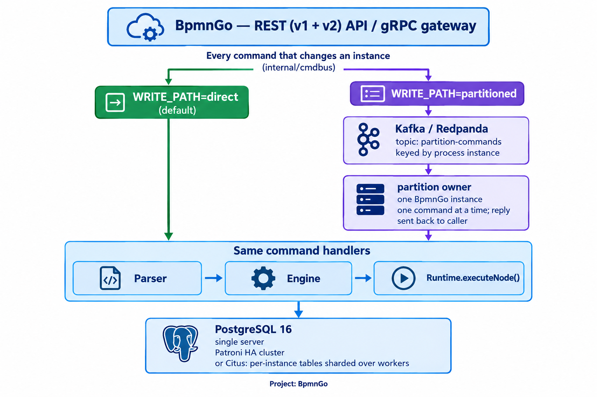

# BpmnGo — Cloud-Native BPMN Workflow Engine


BpmnGo is a BPMN 2.0 workflow engine written in Go that runs models with Camunda 8 semantics, exposing REST APIs shaped after both **Camunda 7** (`/engine-rest/...`) and **Camunda 8** (`/v2/...`), plus a native **Zeebe gRPC gateway**. It's a lightweight, self-hosted alternative to the Java-based engines: PostgreSQL is its only database (a single server, a high-availability cluster with automatic failover, or a Citus cluster sharding the per-instance tables), the application runs as one instance or several behind a load balancer, and it comes with real-time event streaming and a React operations/tasklist frontend. Like Camunda 8, it can run every command of an instance on the one BpmnGo instance owning its Kafka partition, with failover between instances. See [Comparison to Camunda 7 / Camunda 8](docs/comparison.md#comparison-to-camunda-7--camunda-8) for an honest look at what's covered and what isn't, and [Switching from Camunda 7 / Camunda 8](docs/switching-from-camunda.md#switching-from-camunda-7--camunda-8) for what an existing Camunda application has to change.

## Contents

- [Current State](#current-state-v102)
- [Quick Start](#quick-start)
- [Architecture](#architecture)
- [Documentation](#documentation)

---

## Current State (v1.0.2)

**BpmnGo 1.0.2 is production ready.** What backs this:

- **Tested end to end:** 53 integration suites run against a real Postgres + BpmnGo stack, in every deployment mode (single server, several instances, Patroni HA cluster, Citus, partitioned write path). See [Integration Tests](docs/testing.md).
- **No single point of failure:** several BpmnGo instances behind a load balancer, and a Patroni cluster with automatic failover. In the failover drill, a replica took over within 28 s with no instance lost. See [Operations](docs/operations.md#postgres-high-availability).
- **Backups:** `pg_dump` backups, with a script that checks each backup restores. See [Operations](docs/operations.md#backups).
- **Secure defaults:** with `GOFLOW_ENV=production`, the server refuses to start with a sample JWT secret, and warns when `/metrics` is left without `METRICS_TOKEN`.
- **Operable:** Prometheus metrics, history retention, manual SQL migrations from a baseline, load-testing script. See [Operations](docs/operations.md).

What BpmnGo does not cover yet compared with Camunda is listed in [Comparison to Camunda 7 / Camunda 8](docs/comparison.md).

### BPMN 2.0 Support

Every supported element (events, tasks, gateways, sub-processes, multi-instance, compensation, timers…) is listed in [BPMN 2.0 Support](docs/bpmn-support.md).

### Engine Features

Versioning, FEEL, job workers, incidents, DMN, multi-tenancy, authentication, audit trail, real-time events, scaling, high availability, gRPC… are listed in [Engine Features](docs/engine-features.md).

---

## Quick Start

Requires Docker with Compose v2.

### Try it — no configuration

```bash
git clone https://github.com/jeremielodi/bpmngo.git
cd bpmngo
docker compose up -d --build --wait     # PostgreSQL, BpmnGo and the web app
./scripts/demo.sh                       # your first workflow, end to end
```

With no `.env`, BpmnGo starts in **demo mode**: it generates its token-signing key (kept in the `bpmngo_data` volume) and the admin account is `admin@goflow.com` / `admin123`. Fine to try BpmnGo, not for production (see below).

Then open the web app at `http://localhost:3000` and log in as `admin@goflow.com` / `admin123`. On Windows, run the script from Git Bash.

### Your first workflow

[`examples/hello-world.bpmn`](examples/hello-world.bpmn): someone reviews a request, then it is approved or rejected. `./scripts/demo.sh` runs it through the Camunda 8 style REST API, four calls:

| Step | Call |
|---|---|
| Deploy the process | `POST /v2/resources/deployments` (the `.bpmn` file as `resources`) |
| Start an instance | `POST /v2/process-instances` `{"processDefinitionId": "hello_world", "variables": {...}}` |
| Find its waiting task | `POST /v2/user-tasks/search` `{"filter": {"processInstanceKey": "..."}}` |
| Complete it | `POST /v2/user-tasks/<userTaskKey>/completion` `{"variables": {"approved": true}}` |

`./scripts/demo.sh --ui` stops once the task waits: complete it yourself on the web app's **Tasks** page, and follow the instance on **Process Instances**. To draw your own process, use the web app's **Modeler** page. For everything else — job workers, the Camunda 7 API, the Zeebe gRPC gateway — see [Documentation](#documentation).

### For production

```bash
cp .env.example .env
```

In `.env`, set at least:

- `JWT_SECRET_KEY` — a real random secret, e.g. the output of `openssl rand -base64 48`. With it set, BpmnGo runs in production mode (`GOFLOW_ENV=production`): it refuses to start with a sample value such as `change_me`, and warns about an unprotected `/metrics` or the sample admin password.
- `SUPER_USER_PASSWORD` — the password of the admin account created at first start (`SUPER_USER_EMAIL`, `admin@goflow.com` by default).

Then `docker compose up -d --build --wait`, and check with `curl http://localhost:8080/health`. A database created this way already has the full schema; when upgrading an existing one, apply the new files of [`database/migrations/`](database/migrations/README.md) first.

| What | Where |
|---|---|
| Frontend | `http://localhost:3000` — see [Frontend](docs/frontend.md) |
| REST API | `http://localhost:8080` (Camunda 7 style `/engine-rest/...`, Camunda 8 style `/v2/...`) — see [API Reference](docs/api.md) |
| gRPC (Zeebe protocol) | `localhost:26500` — every call needs credentials (JWT, OIDC or Basic) |

The ports come from `SERVER_PORT` and `FRONTEND_PORT` in `.env`. Kafka (Redpanda) is not started: only the partitioned write path needs it (see [Environment Variables](docs/configuration.md)). To stop: `docker compose down` (add `-v` to also delete the data).

---

## Architecture

Every request goes through the same parser/engine/runtime and lands in the same PostgreSQL database. What the deployment chooses (`WRITE_PATH`) is *where* each command runs: right where it arrives (`direct`, the default), or — like Camunda 8 — on the one BpmnGo instance owning the Kafka partition of its process instance (`partitioned`).



Design decisions and the partitioned write path: [docs/architecture.md](docs/architecture.md).

---

## Documentation

- [Switching from Camunda 7 / Camunda 8](docs/switching-from-camunda.md) — what an application already on Camunda changes, client by client
- [Comparison to Camunda 7 / Camunda 8](docs/comparison.md) — what's covered and what isn't
- [BPMN 2.0 Support](docs/bpmn-support.md) — every supported BPMN element, timers, conditional events, known limits
- [Engine Features](docs/engine-features.md) — everything besides BPMN elements: FEEL, jobs, incidents, DMN, auth, scaling, HA, gRPC
- [API Reference](docs/api.md) — REST (`/engine-rest`, `/v2`), events, audit trail, every filter
- [Frontend](docs/frontend.md) — the web app: pages, modeler, running it in Docker or with Vite, its tests
- [Java client](docs/java-client.md) — a remote Java application over REST, the Camunda 7 External Task Client or the Camunda 8 Java client, with tested examples
- [Architecture](docs/architecture.md) — design decisions, partitioned write path
- [Environment Variables](docs/configuration.md) — every setting
- [Operations](docs/operations.md) — migrations, metrics, backups, scaling, high availability
- [Ajouter des serveurs](docs/adding-servers.md) — de 1 à 4 serveurs et plus : quels fichiers, et ce qu'il faut faire côté base de données à chaque étape
- [Integration Tests](docs/testing.md) — the suites and how to run them
- [Roadmap](docs/roadmap.md) — what's done and what's next
- [`architecture/`](architecture/) — design documents (partitioned write path, Citus storage, history of the event-sourced phases)
- [`database/migrations/`](database/migrations/README.md) — the SQL migrations, applied by hand
